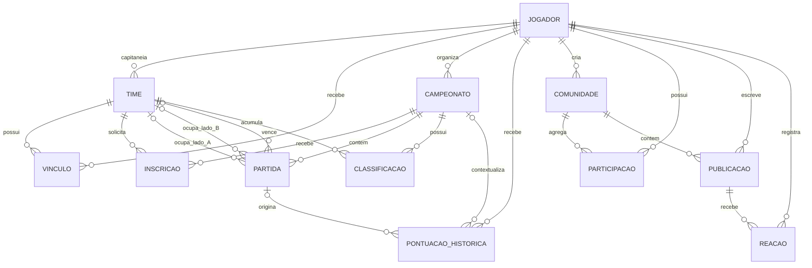

# Modelo conceitual

[Abrir diagrama SVG para ampliar](modelo-conceitual.svg).

O domínio combina organização de campeonatos e interação entre jogadores.
Capitão, organizador, autor e dono são papéis de um jogador em determinado
registro; não são tipos globais de usuário nem tabelas de administradores.

## Entidades e significado

| Conceito | Informação principal | Implementação |
| --- | --- | --- |
| Jogador | Nome, usuário, bio, estatísticas e identidade | jogadores |
| Time | Nome, capitão, imagem e situação | times |
| Vínculo | Convite ou participação de um jogador em time, com datas | contratos |
| Campeonato | Jogo, formato, período, organizador e limite | campeonatos |
| Inscrição | Time solicitante, campeonato e aprovação | inscricoes |
| Partida | Rodada, dois lados, placar, vencedor e situação | partidas |
| Classificação | Desempenho de um time em um campeonato | classificacao_campeonatos |
| Pontuação histórica | Pontos individuais originados por um resultado | historico_ranking |
| Comunidade | Grupo social, criador, jogo e categoria | comunidades |
| Participação | Jogador membro e seu papel na comunidade | membros_comunidade |
| Publicação | Autor, comunidade, texto e datas | publicacoes |
| Reação | Jogador, publicação e tipo | reacoes_publicacao |

## Cardinalidades e regras complementares

- Um jogador pode ter vários vínculos ao longo do tempo, mas só um ativo.
  Convite pendente ainda não é participação ativa; aceite é decisão do convidado.
- Um time tem um capitão atual e vários vínculos. O capitão é incluído no elenco
  ao criar a equipe. Mudar de capitão exige transferir para outro membro ativo.
- Time e campeonato se relacionam N:N por inscrição; há no máximo uma inscrição
  por par. Inscrições pendentes e aprovadas reservam vagas.
- Cada partida pertence a um campeonato. Os lados podem estar indefinidos nas
  rodadas futuras. Um vencedor pode estar ausente antes da conclusão ou em empate.
  Quando definido, deve ser um dos lados da partida.
- Classificação pertence ao par campeonato/time. Pontuação histórica pertence
  ao jogador e pode manter referências nulas caso o registro referenciado seja
  removido pelas regras físicas; partidas já pontuadas têm proteção de exclusão.
- Jogador e comunidade se relacionam N:N por participação. O criador entra
  automaticamente como dono e não pode simplesmente abandonar sua comunidade.
- Cada jogador tem no máximo uma reação por publicação. A mesma publicação pode
  receber reações de vários jogadores.

Legenda: `||` significa exatamente um; `o|`/`|o`, zero ou um; `o{`, zero ou muitos.
Os limites adicionais são impostos por chaves, índices, triggers e operações
transacionais, descritos no [modelo físico](modelo-fisico.md).

A identidade de login pertence ao Supabase Auth. Um perfil de jogador compartilha
o identificador de uma identidade; a aplicação não cria tabela de senhas própria.
