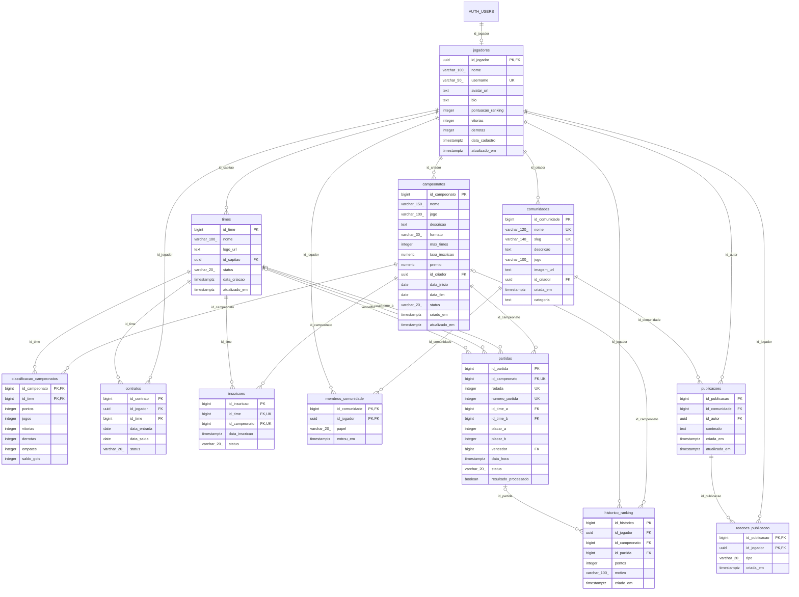

# Modelo lógico

12 tabelas do domínio e 92 atributos. AUTH_USERS pertence ao Supabase, fora dessas 12 tabelas.

[Abrir diagrama SVG para ampliar](modelo-logico.svg).

AUTH_USERS/jogadores usa PK/FK compartilhada: uma identidade possui no máximo um perfil; o trigger o cria no cadastro. As demais cardinalidades mostram as FKs. Restrições de unicidade, índices parciais, triggers e RPCs complementam os limites do diagrama. Consulte o [dicionário completo](dicionario-dados.md) e as [regras e decisões](modelo-fisico.md).
